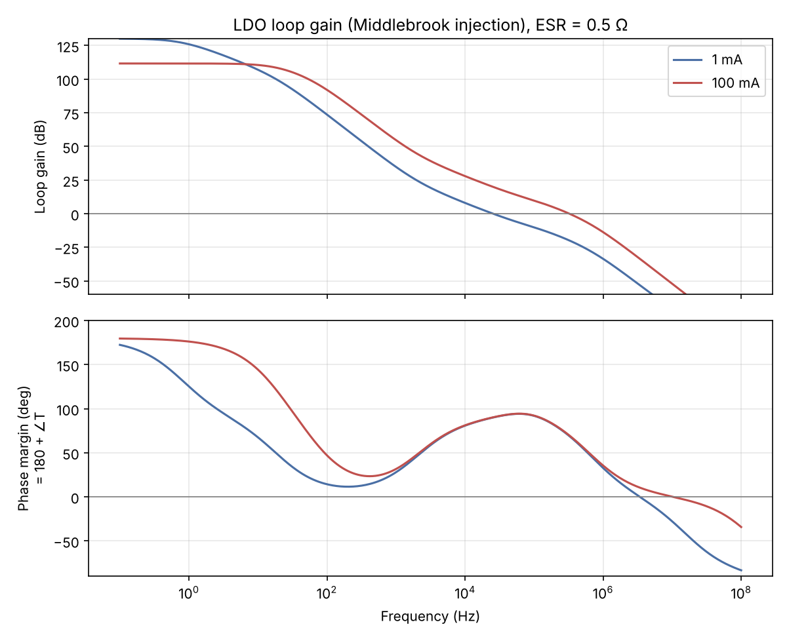
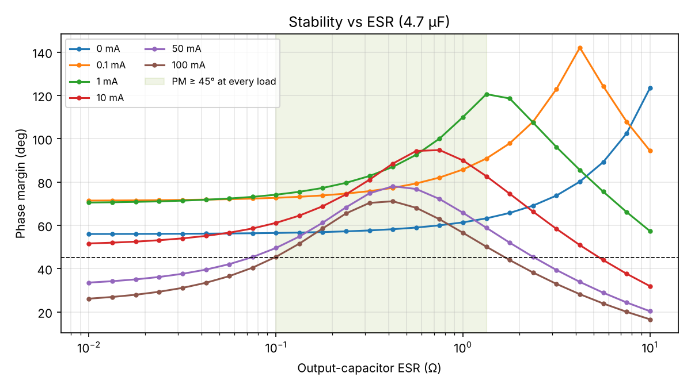
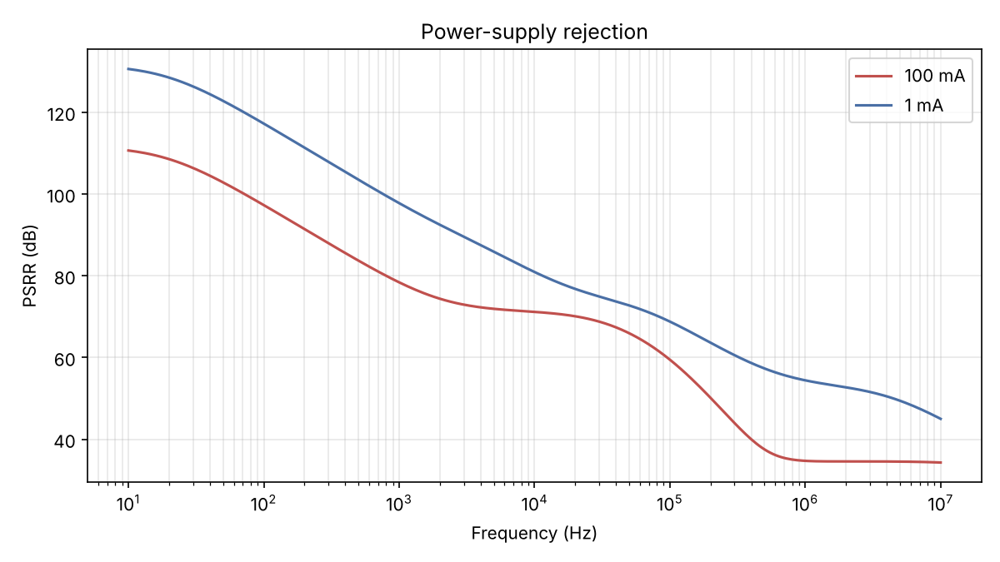
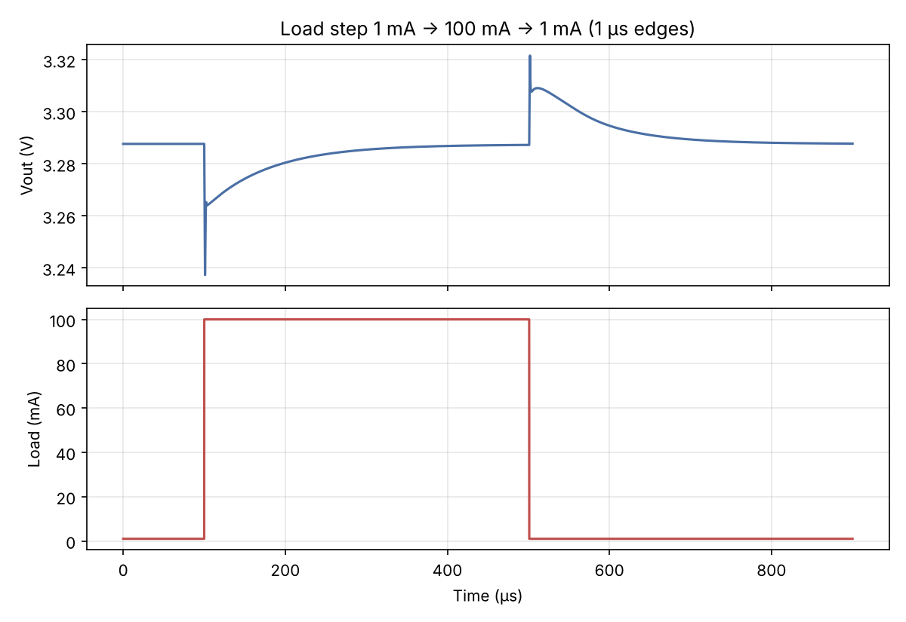

# Low-Dropout (LDO) Voltage Regulator: Design and Stability Analysis

A 5 V → 3.3 V, 100 mA PMOS LDO simulated in SPICE. The study covers dropout, load regulation, loop stability measured by Middlebrook voltage injection across load and output-capacitor ESR, PSRR, and load-transient response.

## 1. Circuit

```
 VIN (5 V) ────────────────┬──────────────────────────┐
                           │ S                        │
                   gate ──┤│  PMOS pass device        │
                    ▲      │ D                        │
                    │      └─────────┬──────────── VOUT (3.29 V)
       ┌────────────┴───┐            │         │           │
       │ Gate driver    │          RF1 174k    COUT 4.7 µF  ILOAD
       │ (ref. to VIN)  │            │           │         (1–100 mA)
       └────────▲───────┘   fbx ─────┤         ESR 0.5 Ω
                │                    │           │
       ┌────────┴───────┐          RF2 100k     GND
 VREF ─┤−  Error amp    │            │
 1.2 V │               +├──── fbx   GND
       └────────────────┘   (VINJ inserted here for loop-gain tests)
```

| Block | Implementation |
|---|---|
| Reference | 1.2 V ideal source |
| Error amplifier | Behavioral: 80 dB DC gain, lag-lead to 40 dB above 2 kHz, pole at 100 kHz, 200 Ω output |
| Gate driver | Referenced to VIN (gate = VIN − drive), so input ripple doesn't change Vsg |
| Pass device | PMOS, level-1 model: Vt = −1 V, W/L = 8 mm / 2 µm, λ = 0.02, ~1.2 nF gate capacitance |
| Feedback | 174 kΩ / 100 kΩ (E96): Vout = 1.2 × (1 + 174/100) = 3.288 V, 12 µA quiescent divider current |
| Output capacitor | 4.7 µF with ESR as a parameter |

All of these live in one file, `ngspice/ldo_core.inc` (the same file is in `ltspice/`). Every test includes it.

## 2. Results

| Metric | Result |
|---|---|
| Output voltage | 3.288 V (1 mA), 3.287 V (100 mA) |
| Load regulation, 1 → 100 mA | 0.24 mV |
| Dropout at 100 mA (Vout 1% low) | 211 mV |
| Phase margin, ESR 0.5 Ω | 59° at 0 mA, 90° at 1 mA, 92° at 10 mA, 78° at 50 mA, 70° at 100 mA |
| Loop crossover | 3.2 kHz (no load) to 325 kHz (100 mA) |
| ESR range with PM ≥ 45° at every load | 0.1 Ω to 1.33 Ω |
| PSRR at 100 mA | 97 dB @ 100 Hz, 78 dB @ 1 kHz, 71 dB @ 10 kHz, 59 dB @ 100 kHz |
| Load step 1 → 100 mA (1 µs edge) | 50 mV undershoot, back within 1% in 1.6 µs, within 10 mV in 70 µs |
| Load step 100 → 1 mA | 34 mV overshoot |






## 3. How to reproduce

**ngspice + Python** (regenerates every number and plot above):
```
python3 python/run_all.py
```
Results go to `results/results.json` and `results/*.png`.

**LTspice**: open the files in `ltspice/` in order (File → Open, file type *.cir), Run, and read the `.meas` results in View → SPICE Error Log.
1. `1_load_regulation.cir`
2. `2_dropout.cir`
3. `3_loop_gain.cir`: plot `-V(fbx)/V(ein)`
4. `4_esr_sweep.cir`
5. `5_psrr.cir`
6. `6_load_transient.cir`

## 4. Design notes

**Loop-gain measurement.** VINJ sits between the divider tap and the error-amp input, where the source side is the divider (~64 kΩ) and the load side is the amplifier's ideal high-impedance input. That satisfies Middlebrook's impedance condition, so T = −V(fbx)/V(ein) gives the true loop gain without breaking the DC operating point.

**Pole/zero picture.**
- *Output pole.* Cout with (RL ∥ ro) moves with load: about 10 Hz at 1 mA and about 1 kHz at 100 mA. That's why crossover moves across two decades.
- *Gate pole.* The driver resistance and the ~1.2 nF gate capacitance, raised by the Miller effect.
- *Error-amp pole.* At 100 kHz.
- *ESR zero.* At 1/(2π·ESR·Cout), which is 68 kHz for 0.5 Ω. This zero supplies the phase that keeps the loop stable.

**ESR window.**
- Below ~0.1 Ω the ESR zero moves too high to help, and phase margin at 100 mA collapses (26° at 10 mΩ).
- Above ~1.3 Ω the zero arrives early, flattens the gain slope, and pushes crossover out to where the gate and amplifier poles take the phase away.
- This is the classic ESR "tunnel of stability" for externally compensated LDOs. A low-ESR ceramic capacitor (~10 mΩ) would need a small series resistor, or a design change, to be stable.

**Why the error amp has a lag-lead shape.** A plain 40 dB amplifier was stable but left a 3% DC error (3.39 V out) and 24 mV of load regulation. Adding gain at DC (80 dB, rolling to 40 dB above 2 kHz) fixes the DC error without changing the loop near crossover.

The cost is the pole-zero doublet, which causes the slow tail after a load step (within 10 mV in 70 µs, within 1 mV in ~240 µs). Moving the zero from 300 Hz to 2 kHz cut that tail by a factor of 1.5. Going further would cost phase margin at no load (41° with the zero at 5 kHz).

**Why the gate driver is referenced to VIN.** With a ground-referenced driver, input ripple appears directly as gate-source voltage on the PMOS, and PSRR was only 31 dB. Referencing the driver to VIN (as real PMOS LDOs do) leaves the pass device's output conductance and Cgd as the main feedthrough paths.

**Load step.** The initial 50 mV dip is almost exactly ΔI × ESR = 100 mA × 0.5 Ω. Before the loop can respond, the capacitor supplies the current through its ESR. The loop then pulls the output back within 1% in 1.6 µs.

**Phase dip at low frequency.** The phase margin trace dips to about 12° near 200 Hz at 1 mA, but the loop gain there is still above 50 dB. That makes the loop conditionally stable: fine for small signals, but a large-signal event that saturates the amplifier could reduce the effective gain into that region.

## 5. Limitations

- The error amplifier and gate driver are behavioral, not transistor-level. The PSRR figures are therefore an upper bound: a real amplifier's own supply rejection would lower them, especially above a few kHz.
- The PMOS is a level-1 model with fixed overlap capacitances, so temperature and process corners aren't covered.
- No current limit, thermal shutdown, or soft-start.
